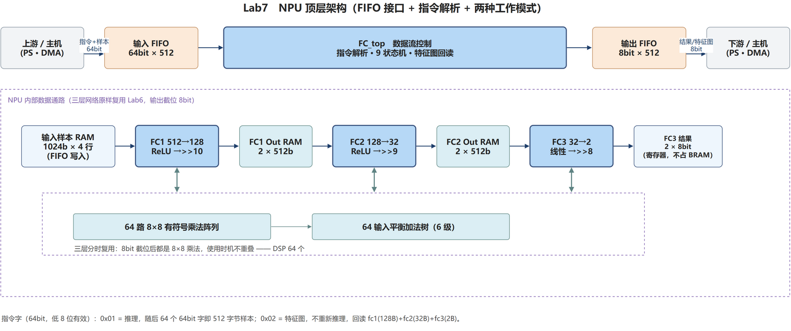

# 01 系统架构

[← 返回总览](00_项目总览.md)

---

## 1. 分层视角

整个系统分成四层，每层只依赖下一层的接口：

| 层 | 内容 | 时钟域 | 文档 |
|---|---|---|---|
| **PS 应用层** | Python（PYNQ）循环 42 次：填缓冲 → 启 DMA → 收结果 → 统计 | ARM 600 MHz | 06 篇 |
| **总线适配层** | AXI DMA（MM2S/S2MM）+ 两个 AXI-Stream 接口 + 异步 FIFO | `s_axis_aclk` | 本文 §4 |
| **控制层** | `fc_top` 的 9 状态机：解析指令、搬数据、选工作模式 | `fc_clk` | 02 篇 §3 |
| **计算层** | 三层全连接：64 路乘法阵列 + 加法树 + 层间 RAM | `fc_clk` | 02 篇 §1–2 |

Lab8 的贡献是**上面两层**（总线适配 + 上板）；下面两层是从 Lab4–Lab7 一路继承下来的。

---

## 2. 顶层框图



> 上图是 Lab7 的 NPU 架构。Lab8 在它外面再套一层 AXI-Stream 适配：

```
            ┌──────────────────── pl_fc_top ────────────────────────────┐
 s_axis ───►│ axis_rd_interface ──► fc_top ──► fc_out_packer ──► axis_wr │───► m_axis
 (64bit)    │  (异步FIFO CDC)      (NPU)      (8bit→64bit)     (异步FIFO)│     (64bit)
            └────────────────────────────────────────────────────────────┘
```

| 模块 | 作用 | 来源 |
|---|---|---|
| `axis_rd_interface` | AXI-Stream 从机 → 异步 FIFO → `din/din_valid/din_ready/fifo_empty` | 改编自 Lab1 |
| `fc_top` | 指令解析 + 9 状态机 + 三层数据通路 | Lab7（只多了 `output_data_last` 一个端口） |
| `fc_out_packer` | 8bit 字节流 → 64bit AXI-Stream 字 | Lab8 新增 |
| `axis_wr_interface` | 异步 FIFO → AXI-Stream 主机（含 tlast） | 改编自 Lab1 |

---

## 3. 数据流

### 3.1 推理模式（指令 0x01）

```
PS: 把 42×( [指令字][64 个样本字] ) 填进 DDR 缓冲（42 × 520 = 21,840 字节）
      │
      ▼  MM2S DMA（一笔传完整批）
s_axis ─► 异步FIFO ─► fc_top.S_IDLE → S_COMMAND（读指令）→ S_DATA_RCV（收 64 字）
                                                     │        ▲
                                                     │        └─ 批内下一张回到 S_COMMAND
                                                     ▼  写输入样本 RAM（4 行 × 1024bit）
                                              S_FC1 → S_FC2 → S_FC3
                                                     │
                                                     ▼
                                              S_FC3_OUT（1 字节结果，y1>y2?0:1）
      │                                                 │
      │                                                 └─ 每张 1 字节，批内累计
      ▼  packer（每满 8 字节打包成 64bit）+ 异步FIFO
m_axis ─► S2MM DMA ─► PS 读回 42 字节（6 拍，末拍 2 字节有效）
```

**批处理的关键判据**：指令字 `[15:8]` 携带本批剩余张数，`fc_top` 内部用 `batch_left`
递减，**只有减到 1 时才产生 `output_data_last`**。因为 simple 模式下 S2MM 收到第一个
`tlast` 就结束传输，若每张都拉，42 张只会收到第一张。

**时序**：单张整包共 1339 拍，125 MHz 下 **10.712 µs**；其中**三层计算本身是 1144 拍、
9.152 µs**（这是汇报 PPT 采用的口径），另外 195 拍是命令字、收 64 个样本字与输出。
100 MHz 约束版整包为 13.39 µs。批处理只影响 DMA 的组织方式，不改变这些拍数。拆开看：

| 阶段 | 拍数 | 占比 |
|---|---|---|
| 命令字 | 1 | 0.1 % |
| 收样本（64 字） | 192 | 14.3 % |
| FC1（128 通道 × 8 组） | 1042 | **77.8 %** |
| FC2（32 通道 × 2 组） | 82 | 6.1 % |
| FC3（2 通道 × 1 组） | 20 | 1.5 % |
| 输出 1 字节 | 2 | 0.1 % |

> 拍数由 testbench 用 $realtime 逐状态量出，不是「拍数 × 周期」倒推。

> **FC1 是绝对瓶颈**。这也是 05 篇里"提高并行度"那条优化路的依据。

### 3.2 特征图模式（指令 0x02）

```
PS: 只发 1 个指令字
fc_top: S_IDLE → S_COMMAND → S_FC1_OUT → S_FC2_OUT → S_FC3_OUT → S_IDLE
```

- **不重新推理**，直接读上一次运算留在 BRAM / 寄存器里的结果：
  - `fc1_out_ram`（2 行 × 512bit，128 字节）
  - `fc2_out_ram`（1 行有效，32 字节）
  - `fc3_hold`（2 字节寄存器）
- 输出 162 字节，打包成 21 拍。

---

## 4. 接口契约（上板时最关键的几张表）

### 4.1 AXI-Stream 从机（PS → NPU）

| 信号 | 位宽 | 说明 |
|---|---|---|
| `s_axis_tdata` | 64 | 每个字 8 字节，**第 0 字节在 bit[63:56]**（MSB 优先） |
| `s_axis_tkeep` | 8 | 恒为 0xFF（不裁字节） |
| `s_axis_tlast` | 1 | 第 64 个样本字上拉高 |
| `s_axis_tvalid/tready` | 1 | 标准握手 |

> **为什么是 MSB 优先**：这是从 Lab4 就定下的 coe 格式（`sel_data` 里第 0 个元素在最左边），
> 一路沿用。只要 PS 打包和 PL 解包用同一套约定就正确——但**写反了不会报错，只会结果全错**，
> 我们在 Lab8 的 testbench 里就踩过一次（见 04 篇 §5）。

### 4.2 AXI-Stream 主机（NPU → PS）

| 信号 | 位宽 | 说明 |
|---|---|---|
| `m_axis_tdata` | 64 | 每字 8 字节，**第 0 字节在 bit[7:0]**（LSB 优先） |
| `m_axis_tkeep` | 8 | 有 valid 时全 1 |
| `m_axis_tlast` | 1 | 最后一个字上拉高（由 `output_data_last` 带过来） |

推理模式：1 拍（1 字节 + 7 字节补 0）；特征图模式：21 拍（162 字节，最后一拍 2 字节有效）。

### 4.3 NPU 内部接口（Lab7 定义，Lab8 原样使用）

| 方向 | 信号 | 说明 |
|---|---|---|
| AXI 侧 → NPU | `din` / `din_valid` / `fifo_empty` | 异步 FIFO 读出的数据、读后一拍有效标志、空标志 |
| NPU → AXI 侧 | `din_ready` | 读使能（= 异步 FIFO 的 `rd_en`） |
| NPU → 输出 | `output_data` / `output_data_vld` / `output_data_last` | 逐字节输出 |
| 输出 → NPU | `outfifo_full` | 背压（= 打包级不能接收） |

### 4.4 `s_axis_tkeep` / `s_axis_tlast` 为什么在 IP 内部没有负载

**先说结论：整机综合后不存在悬空接口。** 在 `design_1_wrapper` 这一层，BD 把 `pl_fc_top`
的每个 AXI-Stream 端口都连到了 smartconnect 与 DMA，顶层 `synth_1` 的日志里没有出现任何
与 `s_axis_*` 相关的未连接告警。

会有告警的是 **IP 自己的 OOC 综合**。`pl_fc_top` 单独综合时报 16 条：

```
[Synth 8-7129] Port s_axis_tkeep[n] in module axis_rd_interface is either unconnected or has no load
```

这条告警的含义是"端口有连接，但模块内部没有负载"——`axis_rd_interface.v` 只声明了这两个端口，
函数体一次都没引用，综合器就在本模块内把它们优化掉。**这不是漏接，也不是悬空接口。**

（如果打开 IP 级 schematic 看到它们显示为孤立端口，那是 IP 内部网表的视图，整机层面端口是连着的。）

**为什么不消费它们**：输入协议是**定长**的——1 个指令字 + 64 个样本字 = 65 拍，
每拍 8 个字节全部有效。

| 信号 | 实际取值 | 为什么不消费 |
|---|---|---|
| `s_axis_tkeep` | 恒为 `8'hFF` | 永远不会有"部分字节有效"的拍，8 个字节全要 |
| `s_axis_tlast` | 只在第 65 拍拉高 | NPU 自己数满 64 个字就知道包结束了，不依赖它 |

**依据（答辩时可以直接引用）**：课件第 14 页指定的参考实现
——**Lab1 的 `axis_rd_interface.v` 完全相同**。它的
`s_axis_tkeep` / `s_axis_tlast` 也只声明不使用，综合时同样会产生 `8-7129` 告警。
所以本设计与参考实现一致，不是缺陷。

```verilog
// Lab1 axis_rd_interface.v 原文节选
    input  [7:0]  s_axis_tkeep,     // 声明了
    input         s_axis_tlast,     // 声明了
    ...
    assign s_axis_tready = ~full;
    assign wr_en = s_axis_tvalid & ~full;   // 函数体只用了 tvalid
```

**已知风险（可接受）**：

1. 若 PS 发出**非 8 字节整数倍**的包，最后一拍的无效字节会被当成有效数据写进样本 RAM；
2. 若 PS 少发/多发字，包边界会错位，但**不会报错**（结果只是错的）。

掩护措施：PS 端是定长打包（发送前断言 `len(buf) == 65 * 8`），不会产生非法包。
如果将来要接真正的 AXI-Stream 主机（长度不定），就必须把 tkeep/tlast 消费起来。

> **对比输出侧**：输出**必须**用 tlast（课件第 9 页"写通道在写数据完成时需要设置
> AXI TLAST"、第 13 页"注意在输出特征图时该信号应在何时拉高"）。
> 本设计用一个 **65 位 FIFO** 把 `{last, data}` 一起跨时钟域，
> 没有沿用 Lab1 "借数据最高位当 tlast"（`m_axis_tlast = m_axis_tdata[63]`）的做法
> ——因为我们的数据是 8bit 有符号，最高位有实际含义，不能借。

---

## 5. 时钟与复位

| 时钟 | 来源 | 频率 | 用途 |
|---|---|---|---|
| `FCLK_CLK0` | PS7 | 100 MHz | AXI-Stream 域 + DMA + NPU 计算域（**本设计两者同源**） |
| `peripheral_aresetn` | `proc_sys_reset` | — | 全局复位（低有效） |

**为什么两个域同源还要用异步 FIFO**：
1. 结构上把"总线时钟"和"计算时钟"解耦，改任一频率不用动另一侧；
2. 课件第 12/13 页明确要求"A XI-Stream ↔ fc_clk 跨时钟域"；
3. 仿真里我们特意用 100 MHz / 150 MHz 验证过真跨域（见 04 篇 §4）。

---

## 6. 模块层次（综合后的层级）

```
pl_fc_top
├── axis_rd_interface
│   └── asy_fifo (u_infifo, 64bit × 512)
├── fc_top
│   ├── fc1  ─┐
│   ├── fc2   ├─ 共用 mult_array_8 (64 × mult_8) + adder_tree(64,16→32)
│   ├── fc3  ─┘
│   ├── fc_input_ram / fc1_weight_ram / fc1_bias_ram / fc1_out_ram
│   ├── fc2_weight_ram / fc2_bias_ram / fc2_out_ram
│   └── fc3_weight_ram
├── fc_out_packer
└── axis_wr_interface
    └── asy_fifo (u_outfifo, 65bit × 512，多 1 位存 tlast)
```

> 注意 `asy_fifo` 的输出 FIFO 是 **65 位**：把 `tlast` 和数据一起跨时钟域，
> AXI 侧不用再猜"哪一拍是最后一拍"。

---

## 7. 与参考实现（Lab1）的差异

| | Lab1 | Lab8 |
|---|---|---|
| 数据通路 | 直通 + LED | 三层全连接网络 |
| 输入 FIFO 读侧 | IDLE/FETCH 状态机主动预取 | 由 NPU 的 `din_ready` 直接驱动 |
| 输出 | `tlast = tdata[63]`（借数据最高位） | FIFO 存 65 位，`tlast` 独立 |
| 数据宽度 | 64bit 进、64bit 出 | 64bit 进、**8bit 计算**、64bit 出（中间加打包级） |

第 2 条简化了 Lab1 的预取状态机：因为 NPU 本身就是"要数据才拉 ready"的消费者，
直接把 `din_ready` 接到 FIFO 的 `rd_en`，时序和 Lab7 用 `syn_fifo` 时完全一致，
**NPU 一行代码都不用改**。第 3 条修掉了 Lab1 里"数据最高位被 tlast 占用"的限制
——我们的数据是 8bit 有符号，最高位有实际意义，不能借。

---

[← 上一篇：项目总览](00_项目总览.md) · [文档索引](README.md) · [下一篇：子模块详解 →](02_子模块详解.md)
