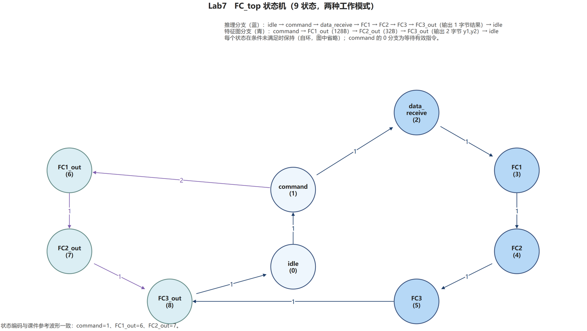

# 02 子模块详解

[← 返回总览](00_项目总览.md)

本篇按数据流顺序讲每个模块：**它解决什么问题 → 怎么设计 → 踩过什么坑 → 怎么验证**。

---

## 1. 通用平衡加法树 `adder_tree.v`

### 1.1 设计

64 个 16bit 有符号乘积求和。要求：全流水、每级只做一个加法、位宽不丢。

- **平衡二叉树**：每级两两相加，`LEVELS = $clog2(NUM_INPUTS)` 级，本设计 6 级。
- **位宽增长**：两个 W 位有符号数相加，结果一定装得下 W+1 位，所以第 k 级后位宽是 `DATA_WIDTH + k`。
  顶层 `WTOP = 16 + 6 = 22` 位，输出再符号扩展到 32 位。**全程不截位，是精确值。**
- **节点存储**：用一个扁平数组 `node[0:NUM_INPUTS-2]`，用公式算每级的起始下标：

```
第 L 级节点数  CNT(L)  = NUM_INPUTS >> L
第 L 级起始下标 BASE(L) = NUM_INPUTS - (NUM_INPUTS >> (L-1))
最后一个节点下标        = NUM_INPUTS - 2
```

### 1.2 踩过的坑

| 坑 | 症状 | 原因 |
|---|---|---|
| 顶层节点取错 | 输出全是 `x` | 读了 `node[NUM_INPUTS-1]`，实际最后一个是 `node[NUM_INPUTS-2]` |
| **符号扩展缺失** | 能编译、仿真全错 | `data[k*DW +: DW]` 是**无符号**部分选择，直接赋给更宽的 signed 线会零扩展 |

第一条用单元测试（全负 / 混合 / 全 1 三组输入 × 3 种配置）暴露，9 项全过。
第二条是最隐蔽的：**综合不报错、仿真不报错，只是负数全算成大的正数。**

```verilog
assign lvl0[i] = {{(WTOP-DATA_WIDTH){data[i*DATA_WIDTH + DATA_WIDTH-1]}},
                   data[i*DATA_WIDTH +: DATA_WIDTH]};   // 必须显式复制符号位
```

---

## 2. 乘法阵列 `mult_array_8.v`

64 个 `mult_gen`（8×8 有符号，`PipeStages=3`）并排，输入 512bit（64 车道 × 8bit），输出 1024bit（64 × 16bit）。

> **`PipeStages` 必须显式设**。不设的话 mult_gen 默认是 1（近乎组合逻辑），
> 延迟链常数全错、时序也过不了。这是 Lab5 踩过的坑。

DSP 占用：8×8 → 1 个 DSP48E1（**注意不是 2 个**，DSP48E1 是 25×18 的，8×8 一次用完）。
Lab5 里 32×8 要 2 个、48×8 要 3 个，所以三层各用各的阵列时总 DSP = 64+64+24 = 152。
Lab6 截位到 8bit 后三层共用这一套 64 个，总 DSP = 64。

---

## 3. 三层计算模块 `fc1.v` / `fc2.v` / `fc3.v`

三层结构高度同构，只有维度、分组数、激活函数不同。

### 3.1 参数对照

| | fc1 | fc2 | fc3 |
|---|---|---|---|
| 维度 | 512 → 128 | 128 → 32 | 32 → 2 |
| 分组 `GROUPS` | 8（512/64） | 2（128/64） | 1（32 放进 64 车道） |
| 输入位宽 | 8 | 8 | 8 |
| 激活 | ReLU | ReLU | **无（线性，可为负）** |
| 权重存储 | 1024bit × 512 | 512bit × 64 | 512bit × 2 |
| 偏置 | BRAM 128 | BRAM 32 | `localparam`（只有 2 个） |
| 输出打包 | 128 字节 → 2 行 | 32 字节 → 1 行 | 直接出寄存器 |

### 3.2 流水线延迟链（全设计最关键的常数）

```
T_PRE    = L_RAM + L_MULT + D_TREE = 3 + 3 + 6 = 12
DLY_ACC  = 12     // 累加器采哪一级的 group_idx
DLY_BIAS = 13     // 加偏置那一级
DLY_OUT  = 15     // 输出寄存器那一级
BIAS_DLY = L_MULT + D_TREE = 9    // 偏置 RAM 的读延迟（与 L_RAM 无关）
```

- `L_RAM = 3` 是 Lab4 **实测**出来的（`.xci` 里写的 `C_READ_LATENCY_A=1` 不可信）。
- `L_MULT = 3` 来自 `PipeStages`。
- `D_TREE = $clog2(64) = 6`。

**为什么这套常数这么重要**：它们是"地址发出 → 结果可用"的拍数。任何一个错 1 拍，
结果就会错位但仍然是一个合法数字——不报错、不 `x`，只是全错。

### 3.3 三个关键设计点

**① 单累加器不变量**

一个输出通道要累加 `GROUPS` 组的结果。因为 `out_channel` 只在 `group_idx` 回绕那一拍 +1，
同一个通道的各组是**连续到达**的，所以 1 个累加器就够：

```verilog
if (group_idx_dly[DLY_ACC] == 0) accum_reg <= final_sum;   // 第一组：加载
else                             accum_reg <= accum_reg + final_sum;
```

**② 计数器结束必须回绕**

结束那一拍计数器要回绕到 0，让延迟链自然排空。
如果让它停住，`wren` 会一直为高、`accum_reg` 会继续累加冻结的 `final_sum`，
症状是"只有最后一段通道是错的"。

**③ 半字选择必须与地址同源延迟（仅 fc1）**

fc1 的输入 RAM 一行 1024bit 装 128 字节，一组只用 64 字节，所以要选高低半字。
选择信号必须和地址**同源**、再延迟 `L_RAM` 拍：

```verilog
half_addr_r <= group_idx[0];
half_dly    <= {half_dly[RAM_LATENCY-2:0], half_addr_r};
```

直接用当前 `group_idx[0]` 去选，选的是 3 拍之前那组数据——整层全错。

### 3.4 fc3 的两个特殊处理

- **高 32 车道补 0 权重**：fc3 只有 32 维输入，但阵列有 64 车道。
  在权重 coe 里把车道 32~63 写成 0，乘积恒为 0，就能和 fc1/fc2 共用同一棵 64 输入加法树。
- **`GROUPS=1` 的 wren 陷阱**：`(group_idx_dly[DLY_OUT] == GROUPS-1)` 在 GROUPS=1 时恒为真，
  空闲时 `wren` 会一直为高、每拍吐垃圾。修法是另跟一条 `running` 延迟链来门控：

```verilog
fc_output_wren_o <= running_dly[DLY_OUT] & (group_idx_dly[DLY_OUT] == GROUPS-1);
```

---

## 4. 层间 RAM 与输出打包

### 4.1 打包级

计算模块一拍出一个字节（带 `wren/addr/data`），后面接一个"计数器 + 拼接寄存器"攒成一行：

| 层 | 输出 | 打包方式 | 何时写出 |
|---|---|---|---|
| fc1 | 128 × 8bit | 第 `c/64` 行第 `c%64` 车道 | 攒满 64 个 **或** 最后一个通道 |
| fc2 | 32 × 8bit | 单行低 32 车道 | 最后一个通道（通道 31） |
| fc3 | 2 × 8bit | — | 不进 RAM，直接存寄存器 |

**关键**：最后一行要在最后一个 `wren` 那一拍就用**组合 merge** 写出去，
这样 `done_o` 拉高时数据已经落地，下一层可以立刻启动、不用多等一拍。

### 4.2 三种身份复用同一块 RAM

课件第 10 页强调的重点。以 `fc1_out_ram` 为例：

| 状态 | 地址来源 | 写使能 |
|---|---|---|
| `FC1`（推理写） | fc1 打包级 | `fc1_out_we_pack` |
| `FC2`（推理读） | fc2 的读地址 | **0** |
| `FC1_out`（特征图读） | 特征图行号 | **0** |

用一个三选一 mux 就够了，因为这三种状态**时间上不重叠**：

```verilog
wire [0:0] fc_output_ram_addr = (state == S_FC1)     ? fc1_out_addra_pack :
                                (state == S_FC1_OUT) ? fm_row :
                                                       fc2_in_addr;
wire       fc1_out_wea        = (state == S_FC1) ? fc1_out_we_pack : 1'b0;
```

**读书时写使能强制为 0**，从结构上消除了 READ_FIRST 的同拍读写隐患。

---

## 5. 数据流控制 `fc_top.v`（Lab7）

### 5.1 9 状态机



| 编码 | 状态 | 作用 |
|---|---|---|
| 0 | `idle` | 等输入非空 |
| 1 | `command` | 读指令字并译码 |
| 2 | `data_receive` | 收 64 个 64bit 字，写进输入样本 RAM |
| 3/4/5 | `FC1/FC2/FC3` | 三层计算 |
| 6 | `FC1_out` | 回读 128 字节 |
| 7 | `FC2_out` | 回读 32 字节 |
| 8 | `FC3_out` | 推理：1 字节结果；特征图：2 字节 |

两条支路在 `FC3_out` 汇合，用 `mode_fmap` 区分输出字节数。
编码与课件参考波形一致（波形里能看到 `state` 依次 `1 → 6 → 7`）。

### 5.2 指令协议

| 指令（64bit 字低 8 位） | 含义 | 后续数据 |
|---|---|---|
| `0x01` | 推理 | 64 个 64bit 字 = 512 字节样本 |
| `0x02` | 特征图 | 无 |

### 5.2.1 批处理扩展（Lab8）

Lab8 把指令字的 `[15:8]` 位用作"本批剩余张数"（含当前张），`fc_top` 内部的计数器据此决定
何时产生包尾：

```verilog
batch_left <= (cmd_reg[15:8] == 8'd0) ? 8'd1 : cmd_reg[15:8];  // 装载
if (!mode_fmap && batch_left > 8'd1) batch_left <= batch_left - 1'b1;  // 每张递减
byte_last = ~mode_fmap & (batch_left == 8'd1);                  // 只有最后一张拉高
```

写 0 等价于 1，所以旧的单张脚本不用改；特征图模式恒为单张，每帧都拉 `output_data_last`。

> **⚠️ 这段逻辑曾有一个只在综合阶段暴露的错误**：`batch_left` 的复位写在了另一个
> `always` 块里，综合报 `Synth 8-6859 multi-driven net`，最高位被常量顶掉，
> 批末的 `tlast` 判定随之失效，而行为仿真完全不报错。详见
> [08 篇 §4](08_上板实测记录.md)。

### 5.3 样本接收

输入是 64bit 字，fc1 要 1024bit 一整行，所以**移位拼接**：

```verilog
wire [1023:0] row_full = {row_buf[959:0], din};   // 新字进低位
```

每 16 个字拼成一行，64 个字 = 4 行 = 512 字节。
行内第 0 个字节在最高位（MSB 优先），所以 64bit 字内部的 8 个字节也要 MSB 优先排。

### 5.4 特征图读出的延迟隐藏

课件第 11 页提示"BRAM 读有三拍延迟，可提前切地址隐藏"。本设计做得更彻底——**整行读出来再移位输出**：

```
fm_t = 0 : 给出行地址 0
fm_t = 1 : 给出行地址 1        ← 提前一拍发第二行
fm_t = 3 : 锁存行 0 的数据（地址发出后第 3 拍）
fm_t = 4 : 锁存行 1 的数据
fm_t = 5 : 开始每拍输出 1 字节（128 字节 = 128 拍）
```

读延迟只影响开头 5 拍，输出阶段满速 1 字节/拍，达到理论下限。

### 5.5 输出握手

```verilog
assign fifo_wren  = output_data_vld & ~outfifo_full;   // 真的写进 FIFO
wire   out_ready  = ~output_data_vld | fifo_wren;      // 可以接新字节
```

`output_data_vld` 表示"寄存器上有新字节"，`fifo_wren` 表示"这一拍确实写出去"。
FIFO 满时 vld 保持 1、wren 为 0，字节原地等待——**背压不丢数**。

---

## 6. AXI-Stream 适配层（Lab8）

### 6.1 `axis_rd_interface`

```
s_axis_* (axi域) ──► asy_fifo(64b×512) ──► din / din_valid / fifo_empty (fc域)
```

- 写侧：`s_axis_tready = ~full`，`wr_en = tvalid & ~full`
- 读侧：**直接把 `din_ready` 接到 FIFO 的 `rd_en`**

> 这一步比 Lab1 简单很多。Lab1 用了一个 IDLE/FETCH 状态机主动预取；
> 而 NPU 本身就是"要数据才拉 ready"的消费者，直接透传即可——
> 时序和 Lab7 用 `syn_fifo` 时完全一致，**NPU 一行都不用改**。

> **⚠️ 关于 `s_axis_tkeep` / `s_axis_tlast`**：
> **整机没有悬空接口**——BD 里这两个端口都连着。`pl_fc_top` 单独做 OOC 综合时会报
> `[Synth 8-7129] ... has no load`，意思是"端口有连接、模块内部没用"，不是悬空。
> 原因：输入是定长 65 拍、每拍 8 字节全有效，tkeep 恒为 `8'hFF`，包结束由 NPU 数满
> 64 个字判定，不需要 tlast。**Lab1 的参考实现完全相同**，详见 01 篇 §4.4。

### 6.2 `axis_wr_interface`

```
din/din_vld/din_last (fc域) ──► asy_fifo(65b×512) ──► m_axis_* (axi域)
```

- FIFO 宽度是 **65 位**：`{tlast, data}` 一起跨时钟域，AXI 侧不用猜哪拍是最后一拍。
- 读出用**预取寄存器**把标准 FIFO（读延迟 1 拍）变成 first-word-fall-through：

```verilog
assign rd_en = ~empty & (~ov | m_axis_tready);
// fvalid 来了就把数据锁进 od、ov=1；被 tready 取走时 ov=0
```

稳态 1 beat/cycle。

### 6.3 `fc_out_packer`

把 8bit 字节流攒成 64bit 字（8 字节/字），最后一拍不足 8 字节高位补 0，并把 `last` 一起送下游。

字节序：第 1 个字节放 `word[7:0]`，第 8 个放 `word[63:56]`（LSB 优先）。

---

## 7. 异步 FIFO `asy_fifo.v`

来自 Lab3：格雷码指针 + 双触发器同步，标准的 CDC FIFO。

> **⚠️ 必须修改的地方**：Lab3 的两个 FIFO（`syn_fifo` / `asy_fifo`）都在复位时
> 用 for 循环清零整个存储阵列：
> ```verilog
> if (!rst_n) for (i=0;i<DEPTH;i=i+1) fifo_ram[i] <= 0;   // ← 综合不出 BRAM
> ```
> 仿真没问题，但综合器**推断不出 BRAM**，只能摊成触发器阵列。
> Lab8 第一次综合出来 **76 565 个触发器（72 %）**，两个 FIFO 的存储阵列就占了 6.6 万。
>
> 修法：去掉清零（RAM 内容本来不需要复位，指针复位后 `empty=1`，没写过的地址不会被读），
> 同时去掉 `else fifo_ram[wr_addr] <= fifo_ram[wr_addr];` 这句自赋值：
> ```verilog
> always @(posedge wr_clk)                 // 敏感表里也去掉 rst_n
>     if (wr_en && ~full) fifo_ram[wr_addr] <= din;
> ```
> 改完两个 FIFO 只占约 1.5 个 BRAM tile，触发器回落到 1 万左右。
>
> 这个改动只影响 Lab8 目录下的拷贝，Lab3 工程原文件没有动。

---

## 8. 模块验证方式一览

| 模块 | 验证手段 | 结果 |
|---|---|---|
| `adder_tree` | 单元 testbench：全负 / 混合 / 全 1 × 3 种配置 | 9/9 |
| `fc1/fc2/fc3` | 与官方参考文件逐值比对（Lab5）+ 与 Python 模型比对（Lab6） | 128/128、32/32、2/2；13 608 个值 |
| `fc_top`（Lab7） | 2 个样本 × (推理 + 特征图) + 重复推理 | 3 结果 + 324 字节全对 |
| `pl_fc_top`（Lab8） | AXI-Stream 收发 + 同频 / 跨时钟域两种情形 | 全对 |

详见 [04 验证与测试](04_验证与测试.md)。

---

[← 上一篇：系统架构](01_系统架构.md) · [文档索引](README.md) · [下一篇：截位与量化 →](03_截位与量化.md)
